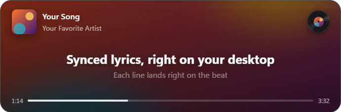

# Lyrics Overlay

Synced lyrics for YouTube Music in a small, always-on-top window on your desktop.



- Lyrics follow the song line by line
- Album-art background and a record that spins while music plays
- Click the cover to shrink the overlay to just the cover (hover it to see the song title); click again to bring it back
- Tray icon, a show/hide hotkey, and a click-through lock so it never gets in the way (locked, it turns
  solid dark so the lyrics stay readable over anything)

## How it works

```
music.youtube.com ──► browser extension ──► ws://127.0.0.1:8765 ──► desktop app ──► LRCLIB / Musixmatch
(the player)          reads song + time      (your computer only)     shows lyrics     (lyrics lookup)
```

Everything runs on your computer. The only thing that leaves it is the song's title, artist and length,
sent to the lyrics service to find the lyrics.

## Install

You need both parts: the desktop app and the browser extension.

> Tested on Windows with Chrome. Other Chromium browsers (Edge, Brave) should work. macOS and Linux
> builds are configured but untested.

### 1. Desktop app

Download `lyrics-overlay-<version>-windows-setup.exe` from the Releases page and run it.

Windows may say "Windows protected your PC" because the installer isn't code-signed. Click
**More info → Run anyway**.

### 2. Browser extension

1. Download `lyrics-overlay-extension-<version>.zip` from the Releases page and unzip it.
2. Open `chrome://extensions` (Edge: `edge://extensions`) and turn on **Developer mode**.
3. Click **Load unpacked** and choose the unzipped folder.

### 3. Play something

Open [music.youtube.com](https://music.youtube.com) and play a song. If the tab was already open, refresh it.

## Using it

| To | Do this |
| --- | --- |
| Show or hide the overlay | Press **Ctrl+Shift+L**, or click the tray icon |
| Move it | Drag it |
| Resize it | Drag an edge |
| Shrink to just the cover / expand | Click the album cover. While shrunk, hover the cover to see the song title. |
| Let clicks pass through (lock) | Hover and click the lock button, or use the tray menu. The overlay turns solid dark while locked. |
| Quit | Right-click the tray icon → **Quit** |

## Build from source

Requires [Node.js](https://nodejs.org) 20 or newer.

```bash
npm install
npm run dev               # starts the app with hot reload
npm run build:extension   # builds the extension into extension/dist
```

Then load the `extension/` folder with **Load unpacked** (see above). After changing extension code,
run `npm run build:extension`, click **Reload** on the extension, and refresh the YouTube Music tab.

To make release files:

```bash
npm run release
```

This creates, in `release/`:

- the installer for your current OS, in `release/<version>/` (Windows installers are built on Windows,
  macOS on macOS, Linux on Linux)
- `lyrics-overlay-extension-<version>.zip`, plus the same files unzipped in `release/extension/`

**Windows: "Cannot create symbolic link" during `npm run build`.** electron-builder's tools archive
contains a few macOS symlinks, and Windows only lets normal users create symlinks in Developer Mode.
Turn on **Developer Mode** (Settings → System → For developers), or run the build once from an
administrator terminal.

## Configuration

| What | Where |
| --- | --- |
| Musixmatch lyrics (optional) | Set the `MUSIXMATCH_API_KEY` environment variable before starting the app. Needs an official Musixmatch API plan that includes synced lyrics ("subtitles"). Without it, lyrics come from LRCLIB. |
| Show/hide hotkey | `TOGGLE_SHORTCUT` in `electron/controls.ts` |
| Port (8765) | `PORT` in `electron/main.ts` and `WS_URL` in `extension/background.ts` |
| Lyrics timing | `LYRICS_LEAD_SECONDS` in `src/App.tsx` (how early each line appears) |

## Extension ID

The app only accepts connections from its own extension, which it recognises by ID. The `key` in
`extension/manifest.json` makes that ID `gdfhcfmlflcmhcfbodkpihmgoaamadjm` on every computer when the
extension is loaded unpacked.

- **Forking with your own key:** put your extension's ID in `ALLOWED_EXTENSION_IDS` in `electron/main.ts`.
- **Publishing to the Chrome Web Store:** the store gives the extension its own ID. Remove `key` from the
  copy you upload, then add the store's ID to `ALLOWED_EXTENSION_IDS`.

## Troubleshooting

- **The overlay says "Waiting for YouTube Music".** Make sure the app is running, then refresh the
  YouTube Music tab. A refresh is needed after installing or reloading the extension.
- **"No lyrics found".** LRCLIB doesn't have synced lyrics for that song (or that version of it).
- **`npm run dev` fails with "does not provide an export named 'BrowserWindow'".** Electron is running
  as plain Node because `ELECTRON_RUN_AS_NODE` is set (some editor extensions set it). Unset it, or
  run the command from a normal terminal.
- **"Port 8765 already in use".** Another copy of the app, or another program, is using that port.

## Project layout

```
electron/    desktop app: window and WebSocket bridge (main.ts), tray/hotkey/lock/compact mode
             (controls.ts), lyrics lookup (lyrics.ts)
src/         the overlay UI (React)
extension/   browser extension: page.ts reads the player, content.ts relays, background.ts sends
             updates to the app
scripts/     release helpers
build/       app icon
```

## Credits

Lyrics come from [LRCLIB](https://lrclib.net), a free community lyrics database, or from Musixmatch
with your own API key. This project isn't affiliated with YouTube, Google or Musixmatch.
